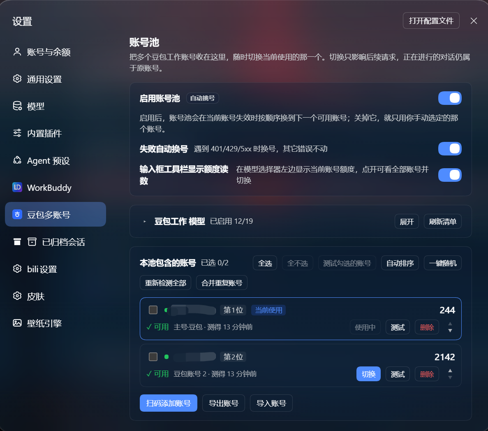
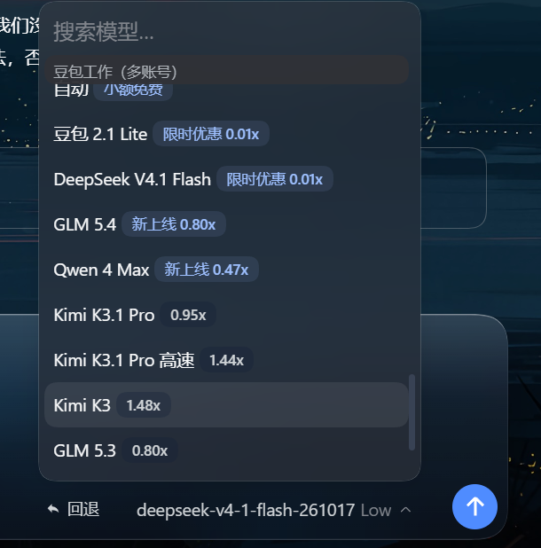
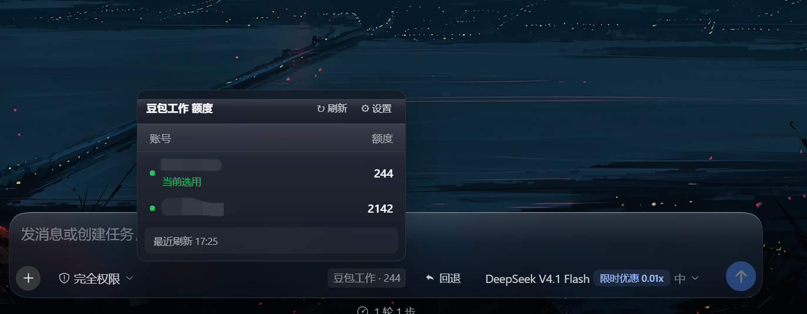

# dsh-connect-doubao-pool · 豆包多账号

给 DeepSeek Harness 一个**自带豆包工作 provider**（`doubao-pool`，显示「豆包工作（多账号）」）+ **账号池**：扫码收纳多个豆包账号，逐号检测可用性与额度，一键切换当前使用的那一个，额度用尽自动换号。

- 设置 → 豆包多账号：账号池主界面（模型勾选也在里面）
- 模型选择器里会多出「豆包工作（多账号）」分组，不需要装豆包插件
- 平台：Windows（凭据用 DPAPI 当前用户加密）

## 界面

设置 → 豆包多账号（蓝底豆图标）：



模型选择器里多一组「豆包工作（多账号）」，第三方模型带倍率徽章：



输入框右侧的额度读数，点开是逐号面板（切号、刷新、跳设置）：



目录结构：

```
index.js                 host 侧：账号池、DPAPI、自有 provider 注册、四条 JSON 路由
client.js                客户端：settings.section 页面 + 导航图标 + 输入框额度读数
lib/doubao-core.js       豆包网页协议（来自 dsh-connect-doubao，MIT）
lib/protocol/index.js    把协议层导出成可读名字
lib/provider/adapter.js  自研 dsh-llm adapter：豆包 SSE → StreamChunk
lib/NOTICE.md            第三方来源与许可
cordis.patch.yml         bundle 注册
docs/DETAIL.md           插件详情页正文
docs/preview.svg         详情页预览图
locale/{zh,en}.json      本地化标题与描述
test/smoke-client.mjs    客户端离线冒烟
test/protocol.test.mjs   工具围栏解析单测（不联网）
test/stream.test.mjs     真实对话冒烟：用池里的号跑一次豆包（联网）
LICENSE                  MIT（本项目）
```

## 安装

DSH → 设置 → 内置插件 → 添加插件，把下面这行贴进输入框，点安装，然后刷新窗口：

```
https://github.com/gwtwly-coder/dsh-connect-doubao-pool
```

装完不用配任何东西（本插件没有构建脚本，pnpm 不会拦 prepare），也没有 npm 之外的运行时依赖。
本地开发时改用绝对路径安装：

```
plugin_manager { action: "install_bundle", target: "D:\\projects\\豆包多账号插件" }
```

用 `application` 字段确认已生效（应为 `"applied"`），然后刷新前端。改过 host 代码后要
`plugin_manager { action: "set_plugin", target: "include:dsh-connect-doubao-pool", enabled: false }`
再 `true` 才会载入新代码；只改 `client.js` 的话刷新页面就够。

自检：

```
node test/protocol.test.mjs      # 不联网
node test/smoke-client.mjs       # 不联网
node test/stream.test.mjs "你好"  # 联网，用池里的当前账号真跑一次
curl http://127.0.0.1:<port>/plugins/doubao-pool/debug
```
