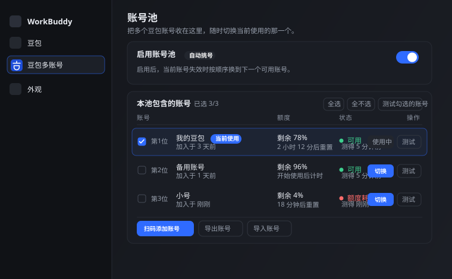

# 豆包多账号

豆包插件（`dsh-connect-doubao`）一次只认一份浏览器登录态：换号就得重新扫码，扫完原来那个号就没法用了。这个插件**自己就是豆包 provider**（`doubao-pool`，显示「豆包工作（多账号）」），旁边挂一个**账号池**：多个豆包账号各自保存好，随时一键切换，额度用尽自动换号。



## 它做什么

- **自带豆包工作模型**：注册自己的 provider「豆包工作（多账号）」，模型选择器里就能选豆包模型，不依赖豆包插件是否安装/启用。模型清单不只是豆包自家 5 个——「工作任务」那套第三方模型（DeepSeek V4.1 Flash / GLM 5.4 / Kimi K3.1 Pro / Qwen 4 Max …）也在里面，一共 17 条。
- **扫码收纳**：点「扫码添加账号」调起豆包官方扫码窗口，扫完把登录态收进池子，原来的当前账号不受影响。
- **逐号体检**：每个账号单独测可用性、读额度（剩余百分比 + 重置倒计时），失败原因直接写在行里。
- **一键换号**：点「切换」，后续对话立刻用这个账号，不用重新扫码。
- **失败自动换号**：打开后，豆包请求撞上 401/402/403/429/5xx（掉登录、没额度、限流）会在**这一次请求内**换成池子里的下一个号重试；400 这类「请求本身有问题」的错误换谁都一样，不换。
- **批量操作**：勾选账号 → 测试勾选的，或者一次「重新检测全部」。
- **排序**：↑↓ 决定优先级，第 1 位就是账号池的首选；另有「自动排序」（可用 → 快过期 → 额度高 → 新号）和「一键随机」。
- **导入导出**：导出的文件是 DPAPI 密封过的字节，带到另一台机器也解不开，用途只有本机备份/迁移。

## 怎么实现的

豆包的网页协议（登录、额度、chat SSE、工具围栏）是抄 `dsh-connect-doubao` 的（MIT，见 `lib/NOTICE.md`），落在 `lib/`：协议层不 import 任何宿主包，adapter 直接实现 DSH 的 `LlmAdapter` 契约。

| 事情 | 做法 |
| --- | --- |
| 每个账号的 cookie | Windows DPAPI（当前用户作用域）加密后存 `~/.dsh/doubao-pool/<id>.dpapi` |
| 池子的元数据 | `~/.dsh/doubao-pool.json`（昵称、顺序、上次检测结果，不含 cookie） |
| 当前用哪个号 | 池子里的 `activeId`；provider 每次请求现取它的凭据（`lib/provider/adapter.js` 的 `resolveCredentials`） |
| 切号 | 改 `activeId` + 把这份凭据写给豆包插件认的 `~/.dsh/doubao-credentials-browser.dpapi`，两个 provider 都不会错位 |
| 测某个账号 | 解封后直接把凭据传给 `probeAccount()` / `fetchQuota({ credentials })`，**不需要**先切换 |
| 扫码加号 | 调豆包插件的 `POST /plugins/dsh-connect-doubao/auth`（它负责拉起 Chromium 扫码），完成后把新登录态收进池子并把原账号写回去 |
| 对话 | `lib/protocol` 的 `streamChat()` 吐豆包 SSE → `lib/provider/adapter.js` 翻成 DSH 的 `StreamChunk`（reasoning / text / tool-call / finish），全程不经过本地回环 HTTP |
| 工具调用 | 豆包没有原生 tool_call：把 DSH 的 `tools` 编译成中文契约，模型吐 ```doubao-tool 围栏，`parseToolCalls()` 解析成 `tool-call` 块，围栏前的正文照常吐字 |
| 输入框读数 | 在模型选择器左边画一行 `额度 · 100%`（照 WorkBuddy 的 composer 读数：12px、label-tertiary、无边框无底色、hover 才给一层淡底）。点开是面板：每个账号一行（状态点、名称、重置倒计时、剩余、切换）。只有当前选中的模型属于豆包时才画，会话换到别家 provider 时这一行消失 |
| 自动换号（兜底） | 监听宿主的 `agent/request-error`（waterfall）：认得出是该换号的失败就切到下一个可用账号，返回 `{ kind: "retry" }`；同一会话 10 分钟内最多换 3 次，避免全池失效时无限重试 |
| 豆包模型清单 | 两条来源合并：静态 5 条（`lib/protocol` 的 `doubaoCatalogEntries()`）+ 豆包自己的模型菜单（`POST /alice/slot/action_bar_v3/brief_list`，用池里当前账号的 cookie 拉，`lib/model-menu.js` 解析）。所以第三方模型（`person-*`）也会出现在清单里，还带倍率（`0.08x`、`限时优惠 0.01x`）。菜单 10 分钟缓存，拉不到就静默回落静态清单 |
| 豆包模型启用 | 勾选写 `~/.dsh/doubao-pool.models.json`，provider 的 `listModels()` 同步读它 —— 保存即生效 |

读写都走本插件自己的路由：`GET /plugins/doubao-pool/state`、`GET /plugins/doubao-pool/models`、`POST /plugins/doubao-pool/action`、`GET /plugins/doubao-pool/debug`（诊断）。写请求必须带 `x-dsh-doubao-pool-write` 头，并且只接受 loopback 的 Host / Origin——网页上的第三方脚本发不出这种请求。

## 依赖

- **可选**：`dsh-connect-doubao` ≥ 0.8.0。装着它时「扫码添加账号」借它的浏览器登录流程最省事，切号也会同步它认的那份凭据文件；没装也能用（`POST /auth` 那一步会报错，但已有账号照常对话）。
- **不依赖**宿主的 `@earendil-works/pi-ai` / `@deepseek-ai/dsh-llm-pi-ai` —— adapter 是自己实现的，只用 `node:*` 内置模块。
- 平台：Windows（DPAPI 是 Windows 用户级加密，别的系统上账号文件既加不了密也解不开）。

## 边界

- 切换账号只影响**后续**请求；已经在跑的对话还是原账号的上下文。
- 池子记录的是「我上次测到它是什么样」，不会在后台定时刷额度；打开设置页时会显示上次结果，30 秒静默刷新一次状态。
- 没有「签到」这类豆包侧不存在的动作——豆包没有签到，硬造一个按钮只会骗人。
- 生图模型（`image-gen`）只出现在勾选清单里；本插件不实现 DSH 的图片工具调用，选它对话会被豆包拒绝。

## 和豆包插件同时开着会怎样

两套 provider 各用各的 id：豆包插件是 `doubao`，本插件是 `doubao-pool`，模型选择器里会出现两个分组，互不影响。区别是本插件的分组才有账号池、换号和输入框额度读数。

## 会话续传（内容审核相关）

豆包网页版每发一条消息只把**新那条**发上去，其余靠 `conversation_id` 挂在同一段会话里。早期版本每轮都把整段 transcript（系统提示 + 全部历史 + 工具契约）压成一条 user 文本重发，内容审核看到的是「一大段指令 + 记录」，比正常聊天更容易被判「涉嫌违反使用规范」。

现在按会话记 `conversation_id` 与已发到第几条消息：能续传就只发增量、且不重发系统提示；`conversation_id` 失效（换号、会话被删）时自动退回完整 transcript 重发一次。换号会清空全部续传记录。

需要知道的是：这条链路走的是豆包网页版对话接口，内容审核由豆包官方判定，插件既不能绕过也不该绕过；WorkBuddy 那边走的是它自己的 OpenAI 兼容接口，审核策略不同，所以同样的话在两边表现可能不一样。

## 账号身份与去重

同一个手机号重新扫码一次，豆包会换一份 `uid_tt`（会话级 cookie）——早期版本拿它当身份，就把一个号收成了两三条，界面上看起来就是「一个账号显示两份」。

现在身份按优先级取：`user_id_str`（`/passport/account/info/v2/` 返回的账号级 id）→ 手机号+昵称 → `uid_tt` 兜底。检测、收号、扫码加号、导入之后都会自动合并重复项，也可以手动点「合并重复账号」。合并时保留加入最早的那条（名字、顺序都不丢），cookie 用较新那份。
